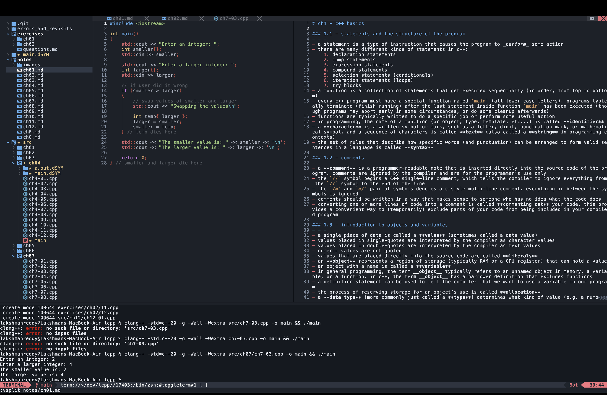

# Neovim IDE Replacement

An NvChad-based terminal IDE configuration for C and C++, with support for Python, Rust, JavaScript, TypeScript, and Lua.

## Features

- NvChad interface with file explorer, tabline, statusline, and terminal workflow
- clangd, pyright, rust-analyzer, ts_ls, and lua_ls through Mason
- nvim-cmp completion with LuaSnip snippets
- codelldb debugging for C and C++
- clang-format, Prettier, Black, and StyLua formatters
- Telescope file and text search
- Trouble diagnostics panel
- Tree-sitter syntax highlighting
- Gitsigns gutter markers

## What the setup looks like

The screenshot below shows the intended day-to-day layout:



- The left sidebar is the project file explorer.
- The upper editor area contains multiple files and splits, so code and notes can be viewed together.
- The bottom panel is the integrated terminal used for compiling and running programs.
- The C++ buffer receives syntax highlighting, completion, clangd diagnostics, and navigation.
- The terminal shows both failed and successful compile commands, warnings, program input, and output.

The terminal prompt in the screenshot is inside the project root. That matters because relative paths such as `src/ch07/ch7-03.cpp` are resolved from the current working directory.

## Requirements

Neovim 0.10 or newer is required. The configuration is intended for macOS, Windows, and Linux. In addition to Neovim, install Git, ripgrep, Node.js, Python, Rust, and a native C/C++ toolchain. Mason installs the language servers, debugger adapter, and formatters after Neovim starts.

### macOS

```sh
xcode-select --install
brew install git ripgrep node python rust
```

Xcode Command Line Tools provide `clang` and `clang++`. Homebrew is available from [brew.sh](https://brew.sh/).

### Windows

PowerShell and Windows Terminal are supported. Install the base tools with `winget`:

```powershell
winget install Neovim.Neovim Git.Git BurntSushi.ripgrep OpenJS.NodeJS Python.Python Rustlang.Rustup LLVM.LLVM
```

If a package ID changes, find its current ID first:

```powershell
winget search neovim
winget search llvm
```

LLVM provides `clang` and `clang++` for C/C++ compilation. Visual Studio Build Tools with the **Desktop development with C++** workload is an alternative compiler toolchain. Restart Windows Terminal after installation so the updated `PATH` is loaded.

### Linux

Ubuntu or Debian:

```sh
sudo apt update
sudo apt install -y git ripgrep build-essential clang lldb nodejs npm python3 python3-pip curl
curl --proto '=https' --tlsv1.2 -sSf https://sh.rustup.rs | sh
```

Fedora:

```sh
sudo dnf install -y git ripgrep gcc-c++ clang lldb nodejs npm python3 python3-pip curl
curl --proto '=https' --tlsv1.2 -sSf https://sh.rustup.rs | sh
```

Arch Linux:

```sh
sudo pacman -Syu --needed git ripgrep base-devel clang lldb nodejs npm python python-pip rust
```

openSUSE:

```sh
sudo zypper install git ripgrep gcc-c++ clang lldb nodejs npm python3 python3-pip rust cargo
```

After installing Rust with `rustup`, restart the shell or load its environment:

```sh
source "$HOME/.cargo/env"
```

## Installation

Back up an existing configuration before installing. Use the command for your operating system.

### macOS and Linux

```sh
if [ -d "$HOME/.config/nvim" ]; then
  mv "$HOME/.config/nvim" "$HOME/.config/nvim.backup"
fi
```

Clone the repository and install the configuration:

```sh
git clone https://github.com/sonstellar969/ide-replacement.git ~/ide-replacement
mkdir -p ~/.config
cp -R ~/ide-replacement/nvim ~/.config/nvim
nvim
```

### Windows PowerShell

```powershell
if (Test-Path "$env:LOCALAPPDATA\nvim") {
  Rename-Item "$env:LOCALAPPDATA\nvim" "$env:LOCALAPPDATA\nvim.backup"
}

git clone https://github.com/sonstellar969/ide-replacement.git "$HOME\ide-replacement"
Copy-Item "$HOME\ide-replacement\nvim" "$env:LOCALAPPDATA\nvim" -Recurse -Force
nvim
```

Neovim looks for its configuration in `~/.config/nvim` on macOS/Linux and in `%LOCALAPPDATA%\nvim` on Windows.

On the first launch, allow lazy.nvim to install plugins. Then restart Neovim and install the language servers, debugger, and formatters:

```vim
:MasonInstall clangd pyright rust-analyzer typescript-language-server lua-language-server codelldb clang-format prettier black stylua
```

On Windows, the Mason package names are the same. The native compiler (`clang++`, `g++`, or `cl`) is separate from Mason and must be installed through LLVM, Visual Studio Build Tools, or your Linux distribution packages.

Install or update Tree-sitter parsers:

```vim
:TSUpdate
:TSInstall c cpp python rust javascript typescript lua
```

## Daily workflow

Open a project from its directory so the explorer and tools use the project as their working directory:

```sh
cd ~/path/to/project
nvim .
```

Open or create a file directly:

```sh
nvim main.cpp
nvim script.py
```

Inside Neovim, use `i` to insert text, `Esc` to return to normal mode, and `:w` to save.

## Keybindings

The leader key is Space.

| Key | Action |
|---|---|
| `Space e` | Toggle the left file explorer |
| `Space t` | Toggle the bottom terminal |
| `Space f f` | Find files |
| `Space f g` | Search project text with live grep |
| `Space f b` | Switch open buffers |
| `Space x x` | Toggle the diagnostics panel |
| `Space b` | Toggle a debugger breakpoint |
| `Space d u` | Toggle the debugger UI |
| `F5` | Start or continue debugging |
| `F10` | Step over |
| `F11` | Step into |
| `g d` | Go to definition |
| `K` | Show symbol documentation |
| `Space r n` | Rename a symbol |
| `Space c a` | Show code actions |
| `Ctrl-Space` | Trigger completion |
| `Tab` | Select completion or expand a snippet |
| `Enter` | Accept the selected completion |

When the terminal has focus, press `Ctrl-\\` followed by `Ctrl-n` to return to Neovim normal mode. Then window navigation works normally with `Ctrl-w` commands.

## C and C++

Compile and run a simple project:

```sh
clang++ -std=c++20 -g -Wall -Wextra main.cpp -o main
./main
```

Or use one command:

```sh
clang++ -std=c++20 -g -Wall -Wextra main.cpp -o main && ./main
```

On Windows PowerShell, the executable normally has an `.exe` suffix:

```powershell
clang++ -std=c++20 -g -Wall -Wextra main.cpp -o main.exe
.\main.exe
```

The `-g` flag includes debug information for codelldb. To debug, compile the executable, set a breakpoint with `Space b`, and press `F5`. If prompted for the executable, enter `./main` on macOS/Linux or `./main.exe` on Windows.

### clangd project flags

For a small project without a build system, create `compile_flags.txt` at the project root:

```text
-std=c++20
-Wall
-Wextra
```

This file configures clangd's completion, diagnostics, header lookup, and navigation. It does not compile the program.

For larger projects, create `compile_commands.json` with one exact compilation command per source file:

```json
[
  {
    "directory": "/Users/yourname/project",
    "command": "clang++ -std=c++20 -Wall -Wextra -c /Users/yourname/project/src/main.cpp -o /tmp/main.o",
    "file": "/Users/yourname/project/src/main.cpp"
  }
]
```

Keep this file at the project root. Check the active language server with:

```vim
:LspInfo
```

## Other languages

```sh
python3 script.py
cargo run
node script.js
lua script.lua
```

The configured language servers provide completion, diagnostics, navigation, rename, and code actions. Formatters run automatically when supported files are saved.

## Maintenance

Use these commands when needed:

```vim
:Lazy sync       " Install plugins or apply config changes
:Lazy update     " Update installed plugins
:Mason           " Open the Mason package manager
:MasonUpdate     " Update Mason package metadata
:TSUpdate        " Update Tree-sitter parsers
:checkhealth     " Run Neovim health checks
:LspInfo         " Inspect the language server for the current buffer
```

Update tools on macOS:

```sh
brew update
brew upgrade
```

Update tools on Windows PowerShell:

```powershell
winget upgrade --all
```

Update tools on Ubuntu/Debian:

```sh
sudo apt update
sudo apt upgrade
```

Update tools on Fedora:

```sh
sudo dnf upgrade
```

Update tools on Arch Linux:

```sh
sudo pacman -Syu
```

Update tools on openSUSE:

```sh
sudo zypper update
```

## Restore the previous configuration

macOS/Linux:

```sh
mv ~/.config/nvim ~/.config/nvim-nvchad
mv ~/.config/nvim.backup ~/.config/nvim
```

Windows PowerShell:

```powershell
Rename-Item "$env:LOCALAPPDATA\nvim" "$env:LOCALAPPDATA\nvim-nvchad"
Rename-Item "$env:LOCALAPPDATA\nvim.backup" "$env:LOCALAPPDATA\nvim"
```
